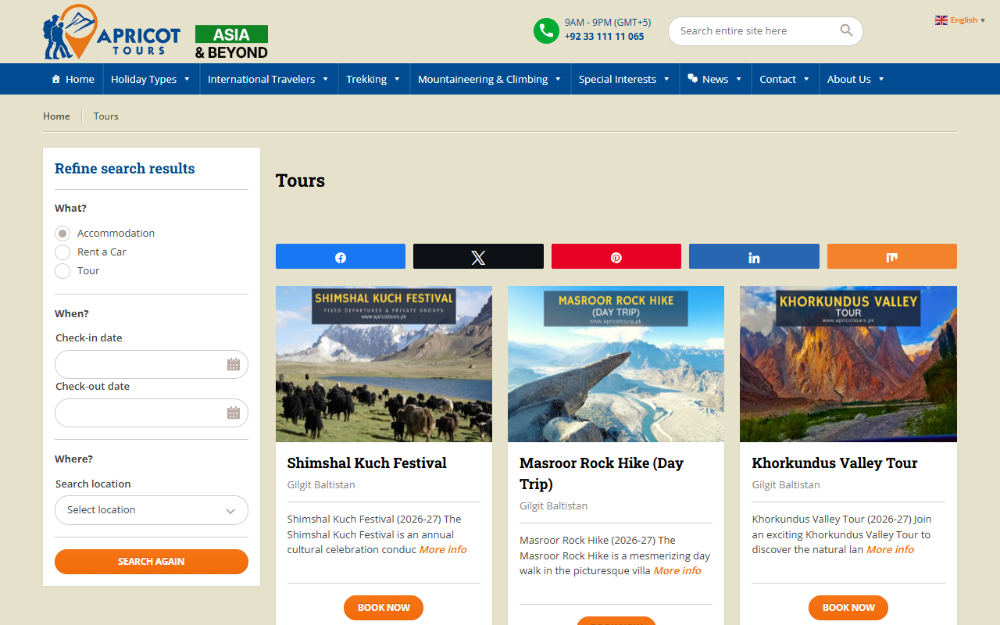
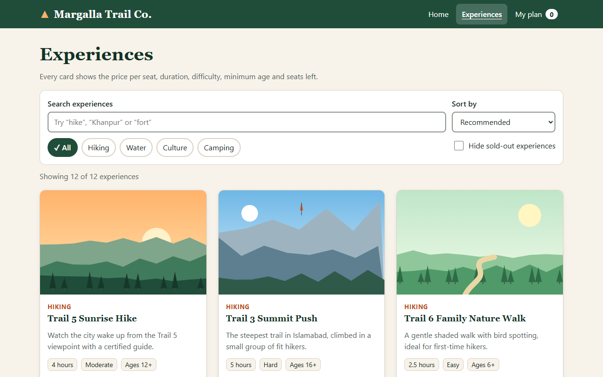
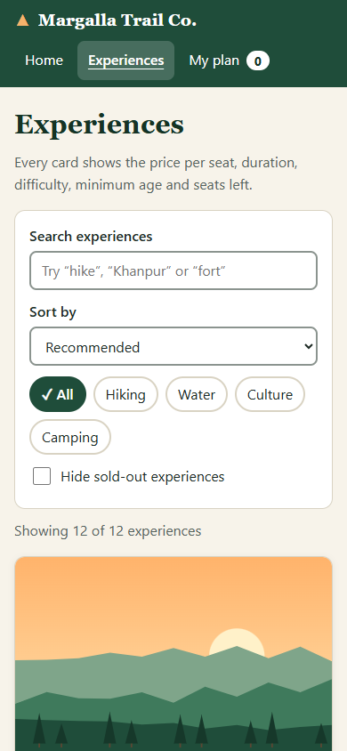
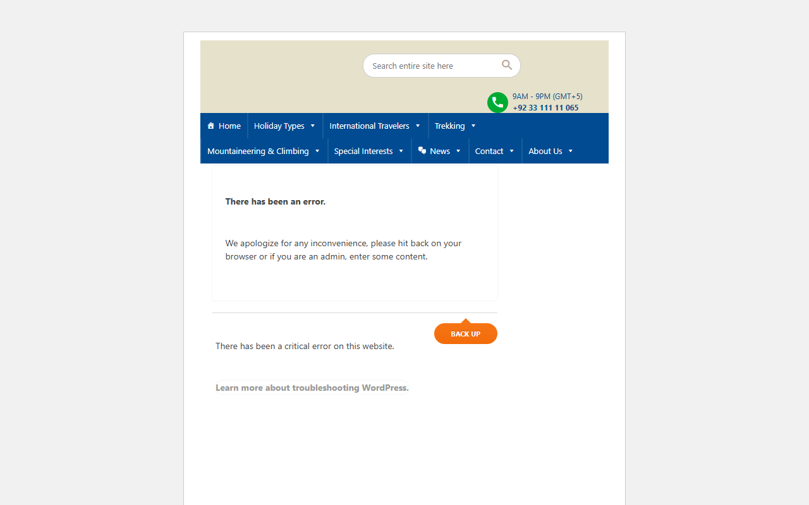
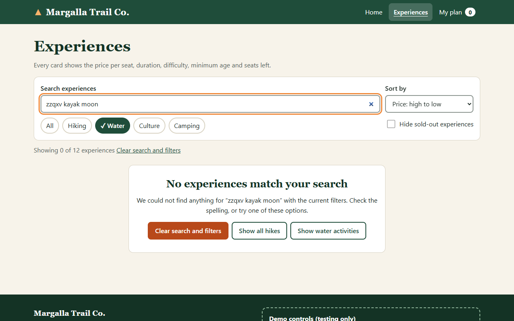
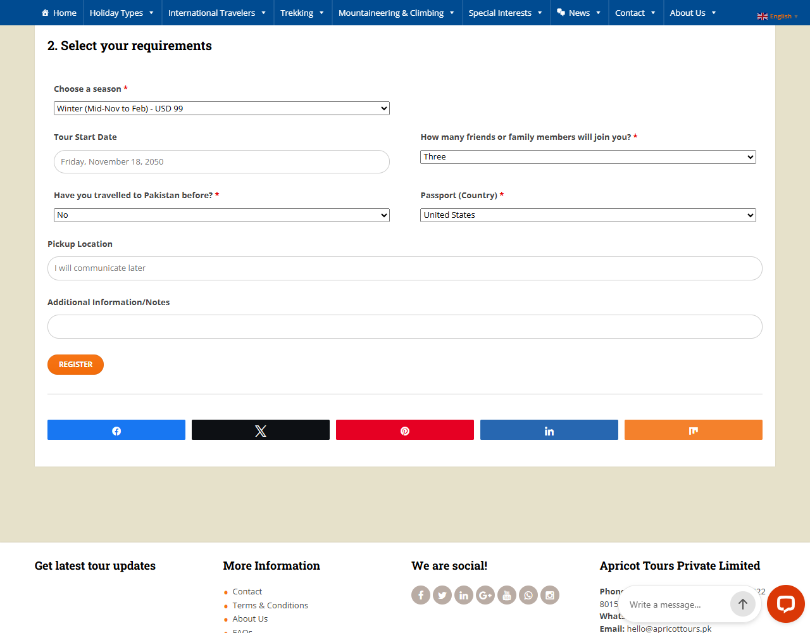
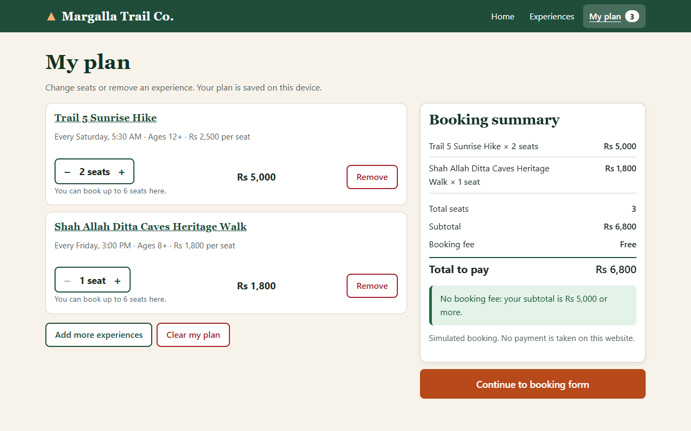
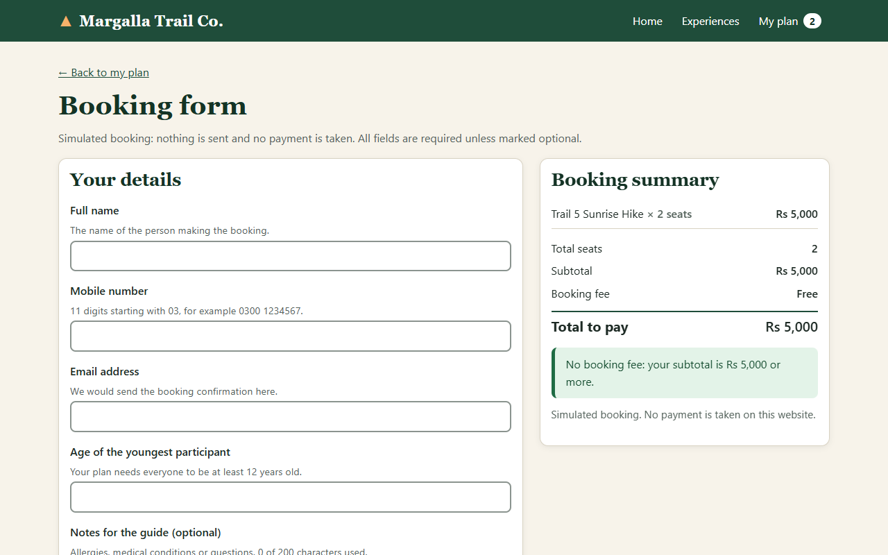

# Frontend decisions

Three decisions, one for each problem found on the reference website
(https://www.apricottours.pk, inspected on 15 November 2026).

- Decision 1 concerns **information hierarchy and mobile layout**.
- Decision 2 concerns **interaction** (recovering from an empty search).
- Decision 3 concerns **React state behaviour** (shared plan state and derived totals).

---

## Decision 1 - Put the comparison facts on every card

| Field | Content |
| --- | --- |
| **Problem** | On the reference tour listing (`/tours/`), each card shows only a photo, the name, the region and a cut-off sentence. Price, duration, difficulty, age limit and availability are missing, so customers must open every tour to compare. At 390 px the filter panel comes first and the first card starts about 1,329 px down the page. |
| **Decision** | Every `ExperienceCard` shows, in a fixed order: category, name, one-line summary, three fact pills (duration, difficulty, minimum age), price per seat and a seats-left badge. On a phone the filter bar is compact, so the first card starts about 625 px down and is visible on the first screen. |
| **Alternative** | Keep cards short (photo and name only) and show the facts in a comparison table on a separate page. |
| **Reason** | Our customers are students and young professionals choosing by budget and fitness. Price, difficulty and age decide whether an experience is even possible for them, so these facts must be visible while scanning the list. |
| **Tradeoff** | Cards are taller, so fewer fit on one screen and the page is longer to scroll on a phone. Long names need wrapping rules to keep the layout stable. |
| **Code location** | `src/components/ExperienceCard.jsx` (component `ExperienceCard`), `src/components/AvailabilityBadge.jsx`, `src/styles/components.css` (`.card`, `.fact-list`, `.card-price-row`, `.card-grid`). |
| **Evidence** | Steps: open `/experiences` at 390 px and at 1280 px. Without opening any details page you can read the price, duration, difficulty, minimum age and seats left of every experience. |

Reference site (problem):

Our website (improvement):

---

## Decision 2 - A no-match search explains itself and offers ways forward

| Field | Content |
| --- | --- |
| **Problem** | On the reference website a search with no matches (we searched "zzqxv kayak moon") shows "There has been an error" and asks the visitor to press the browser Back button. It does not say that nothing matched, and it offers no other tours. |
| **Decision** | When search and filters leave zero results, `ExperiencesPage` shows an empty state that (1) repeats the search text, (2) says nothing matched, and (3) offers three buttons: "Clear search and filters", "Show all hikes" and "Show water activities". A different message is used when the business has no experiences at all. A "Clear search and filters" link also appears beside the result count whenever a filter is active. |
| **Alternative** | Automatically ignore the filters and show all experiences with a small note when nothing matches. |
| **Reason** | The customer keeps control and understands what happened. One click gives real results, so a spelling mistake does not end the visit. |
| **Tradeoff** | The two suggestion buttons are fixed in the code. If the business changes its categories, the buttons must be updated by hand. The page also needs two different empty states, which is more code. |
| **Code location** | `src/pages/ExperiencesPage.jsx` (`handleClearFilters`, `handleShowCategory` and the two `EmptyState` blocks), `src/components/EmptyState.jsx`, `src/utils/filterExperiences.js` (`getVisibleExperiences`, `hasActiveFilters`). |
| **Evidence** | Steps: open `/experiences`, type `zzqxv kayak moon` in the search box. Expected and observed: the message "No experiences match your search" with the typed text and three buttons. Press "Show all hikes": four hiking cards appear. |

Reference site (problem):

Our website (improvement):

---

## Decision 3 - One shared plan in App state, with totals derived from it

| Field | Content |
| --- | --- |
| **Problem** | On the reference registration form the customer chooses a season price ("Winter - USD 99") and how many friends will join ("Three"), but no total is shown anywhere before pressing "Register". The form holds one tour only, and the group size is not connected to the price. |
| **Decision** | The plan is one array in `App` state: `[{ id, seats }]`. Pages change it only through callback props (`handleSetPlanSeats`, `handleRemoveFromPlan`). Line totals, subtotal, booking fee and total are **not stored**. They are calculated on every render by `buildPlanLines` and `calculateTotals`, and the same `OrderSummary` component shows them on the plan page and beside the booking form. The header count, the card "In your plan" label and the summary therefore always agree. |
| **Alternative** | Let each page keep its own copy of the selection and store the total in state, updating it whenever a quantity changes. |
| **Reason** | Customers book for a group, so the total changes with every seat. With one source of truth and derived totals, the total can never be out of date, and the fee rule (Rs 300 under Rs 5,000) is visible before any personal details are typed. |
| **Tradeoff** | `App.jsx` holds more state and passes more props down, so it is the largest file. Totals are recalculated on every render, which is fine for a small plan but would need care with thousands of items. |
| **Code location** | `src/App.jsx` (`planItems` state, `handleSetPlanSeats`, `handleRemoveFromPlan`), `src/utils/planHelpers.js` (`buildPlanLines`, `calculateTotals`), `src/components/OrderSummary.jsx`, `src/rules/bookingFee.js`. |
| **Evidence** | Steps: add 2 seats of "Trail 5 Sunrise Hike" on its details page, then open "My plan". Expected and observed: header shows 2, summary shows subtotal Rs 5,000, booking fee Free, total Rs 5,000. Press the minus button: subtotal Rs 2,500, booking fee Rs 300, total Rs 2,800, and the same numbers appear on the booking form. |

Reference site (problem):

Our website (improvement):

